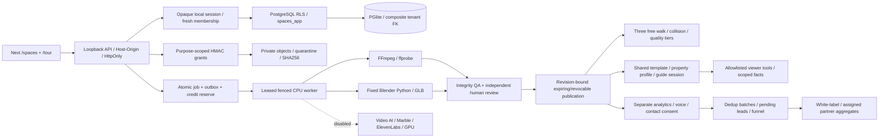
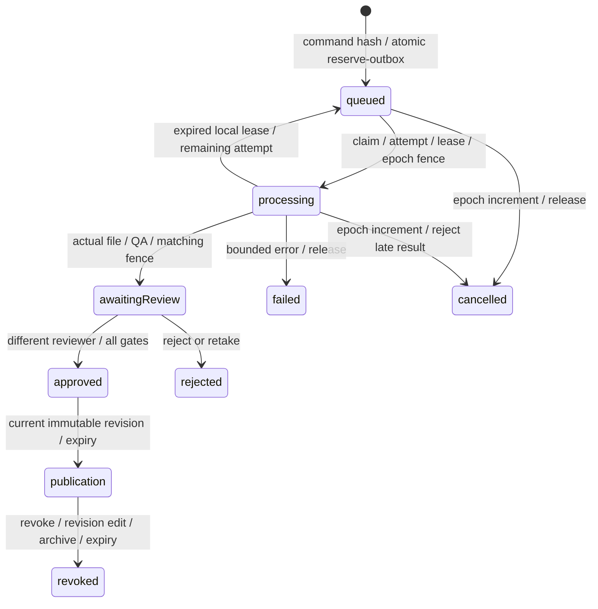
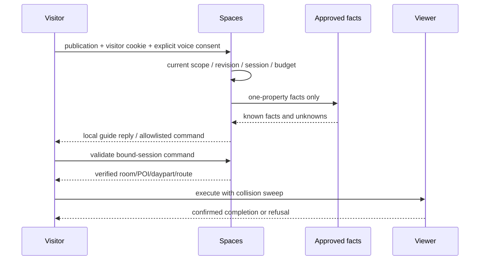

# Spaces V2 — uygulanan yerel mimari

22 Ekim 2026. Eski Phase 1-only belgeleri `docs/archive/` altında korunur. Sürekli geliştirme yetkisi `AGENTS.md` içindedir; harici bütçe 0 USD, canlı servis/deploy kapalıdır.

## Katman ve yetki

`domain`: saf Zod/geometry/shot/finans politikaları; `contracts`: port/DTO; `server`: DB, authorization, storage, workflow, review, guide/analytics; `adapters/providers`: kapalı sağlayıcı sözleşmeleri; `features/platform`: same-origin UI. Domain React/Next/server import etmez; client özel server/Node secret modülü import edemez.

PGlite, PostgreSQL’in gerçek WASM motorudur. RLS testleri `SET LOCAL ROLE spaces_app` altında gerçek SQL çalıştırır. Hosted Supabase, uzak PostgreSQL/Auth/JWKS/Storage **bağlı değildir**. Veri dizini tek Next sürecine aittir; ayrı scheduler loopback API’sini tetikler. Çok makinalı/GPU deployment için harici durable DB/worker izolasyonu ayrıca entegre edilmelidir.

Opaque random test oturumu server’da SHA256 ile saklanır; HttpOnly/SameSite cookie JS’e verilmez. Local kimlik seçimi production auth değildir. Offline ES256/RS256 Supabase uyumlu JWT doğrulayıcı issuer/audience/expiry/algorithm denetler; JWT org/role metadata’sı yetki değildir. İşlem güncel membership + RLS ile yeniden yetkilendirilir. Self membership/organization listesi dışında tenant GUC + role birlikte gerekir. App rolü private session/ledger/publication yazamaz.

## İş ve yayın

En fazla iki yerel deneme ve tenant başına üç aktif iş. Outbox/credit reserve aynı transaction’da; attempt kayıtları ayrı provenance taşır. Artifact adı job+fence’dir: geç worker yeni dosyayı ezemez. Cancel/expired fence DB sonucunu kabul ettirmez; download SHA256 kontrolünden geçer. Harici submit kabulü belirsizse `unknown-submission` hold; ücretli tekrar/fallback yoktur. Circuit/capacity politikaları offline test edilir; gerçek GPU concurrency UNKNOWN’dır.

E0 concept / E1 görsel / E2 ölçülü spatial ayrılır. Manifest evidence ID/kapı/ölçek kontrolü vardır; LLM ölçü/yayın izni veremez. Fixed Blender template dışında kullanıcı Python/.blend çalışmaz. CPU süreçlerinde argv, timeout, resource limit ve secret içermeyen environment vardır; bu tam OS/container sandbox değildir, production worker izolasyonu açılış engelidir.

Kaynaklar web root dışında 0700 klasör/0600 dosyadır. ≤5 MiB JPEG/PNG/WebP magic/decode/pixel sınırı, EXIF/GPS/XMP çıkarma, hash, quarantine ve atomic quota vardır. Signature kontrolü tam antivirus değildir; PDF/gerçek walkthrough ingestion desteklenmez. Upload grant tek kullanımlı asset ID + session/property/revision’a bağlıdır. Source/output/publication/visitor/voice farklı purpose taşır. Yayın ham kaynak açmaz; yalnız gözden geçirilmiş güncel sürümü açar.

## Rehber, analiz ve marka

Tek Spaces template, mülk+revizyon için ayrı profile, ziyaret için ayrı GuideSession vardır; bunlar ElevenLabs agent resource’u değildir. Mevcut canlı website-demo agent kullanılmaz/değiştirilmez. Gerçek request builder, SDK private WebSocket şekli ve HMAC minimum-data webhook ingestion offline test edilir. Credential endpoint 403, CSP external connect kapalıdır. Rehber yerel deterministik simülasyondur; mikrofon testi stream’i hemen kapatır, remote speech recognition yoktur. Cihaz TTS yalnız `localService` sesi kullanır. Ham ses/transcript kaydedilmez.

Analiz tenant/approved revision/visitor cookie ile server’da scope edilir; client org alanı reddedilir. Batch≤32, whitelist, timestamp/ID, 60 olay/dakika, TTL/dedup vardır; bot/opt-out olayları düşer. Huni tekil izinli oturum bazındadır; tekrar launch/lead dönüşümü iki kez saymaz. Contact şifreli; özel okuma admin+audit gerektirir. Authenticated CRM simülasyonu `CONFIRMED_SIMULATED`, gerçek satış/booking değildir. Post-call LLM etiketi commercial truth değildir.

Partner yalnız atanmış/izinli aggregate alır; child membership/raw medya/lead miras almaz. Marka HTML/JS/CSS/iframe kabul etmez; logo temiz tenant-owned asset olmalıdır. `.localhost` domain fixture’dır; DNS/real embed/deployment ve reseller sözleşmeleri kapalıdır.

## Açılış engelleri

Statik hydration için CSP `unsafe-inline` istisnası bulunur; arbitrary HTML render yoktur; production nonce CSP ayrıca gerekir. Safari, bağımsız pentest, full AV/OS sandbox, external DB/queue restore, DPA/KVKK/GDPR/Unreal/World Labs hakları ve gerçek pilot test edilmedi. Bu sürüm üretime açılamaz. Güncel test/CI/PR kanıtı kapanış raporu/checkpoint içindedir.
